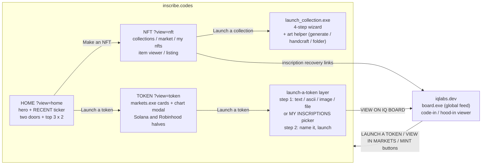
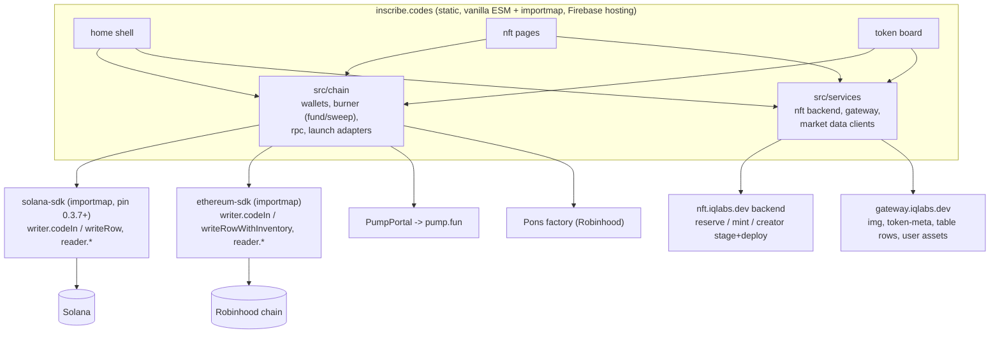

# inscribe.codes

Inscription-first launchpad for NFTs and tokens, split out of the iq6900 site. Every NFT and every token here starts as an inscription: the file itself written to the chain. No IPFS, no server, no takedown.

This repo is the new site. iq6900.com / iqlabs.dev keep the inscription board (Code In / HOOD IN) and link here for launching; this site links back to the board. The two repos share NO code: all site code here is written fresh under the rules in `CLAUDE.md`, and every chain read/write goes through the published SDKs (imported, never copied). iq6900 is a behavioral reference only.

## Site structure

The whole site is one page shell (ported from `design/Home v5 Dark.dc.html`) with three views routed by `?view=`:



## Architecture



Shared state that crosses the two sites:

- The burner keypair is derived from one fixed wallet `signMessage` string. That string MUST stay byte-identical with iqlabs.dev so a user has ONE burner everywhere (inventory shows up in MY INSCRIPTIONS, and the ~0.05 SOL account init rent is never paid twice).
- `localStorage` checkpoints do NOT cross origins: an in-progress deploy started on iqlabs.dev cannot resume here. Launch flows move here wholesale, so this only matters during the cutover.

## Repository layout

```
index.html          single entry: importmap (SDK pins), fonts, ?view= router mount
src/
  main.js           router + page shell, nothing else
  views/            route-level controllers only (one per screen)
    home.js
    token/          board, markets, chart modal, launch layer
    nft/            launchpad, collection page, viewer, studio wizard
  chain/            everything that signs or derives keys
    wallets.js      Wallet Standard discovery + adapter
    burner.js       derivation (message string identical to iqlabs.dev), fund, sweep
    rpc.js          endpoints per chain, setRpcUrl pool wiring
    launch/         pumpfun.js, pons.js (external launch services)
  services/         plain HTTP clients, no chain code
    nft-backend.js  nft.iqlabs.dev
    gateway.js      gateway.iqlabs.dev
    markets.js      dexscreener / geckoterminal
  ui/               shared presentational pieces (window chrome, modal, progress, ticker)
  styles/
public/             fonts, img, favicon (static bytes only)
tests/              node test harness, mirrors src/
design/             design export, reference only
```

Reasons, so the shape is defendable and not incidental:

- **No build step.** Both SDKs ship browser-ready ESM on jsdelivr and the importmap path has run in production on iq6900 for over a year. A bundler would add a toolchain whose main benefits (tree-shaking, transpilation) this small site does not use; shipped source stays byte-identical to the repo, which makes production debugging trivial. If a real need for a bundler appears, that is a design conversation first (CLAUDE.md rule 5).
- **views / chain / services / ui is a responsibility split, not a file-count split.** `chain/` is the only place allowed to touch keys or SDK writers; `services/` is the only place allowed to fetch our backends; `views/` orchestrates and renders. A bug class maps to one directory.
- **No `utils/`.** A helper lives next to its only caller until a second caller exists. Dumping grounds are where duplicate-purpose functions breed (CLAUDE.md rule 2).

Coding rules, including the SDK high-level-only policy, live in `CLAUDE.md` and are binding.

## Development plan

| Phase | Work | Notes |
| --- | --- | --- |
| 0 | Scaffold: repo, static shell, fonts, `?view=` routing, design port of the Home v5 Dark frame | this commit holds the design export under `design/` |
| 1 | Home: hero, RECENT ticker, top 3 collections (backend `/c`), top 3 tokens (markets data), live labels | real data, no mock rows |
| 2 | Token side (`Board v5`): markets cards + chart modal, launch layer (inscribe via `writer.codeIn` / `writeRow`, then PumpPortal / Pons), MY INSCRIPTIONS picker via gateway `/user/{wallet}/assets` | Solana + Robinhood in one page, theme switch; iq6900's token_launch / pons_launch are behavioral reference only |
| 3 | NFT side (`NFT Launchpad Flow v5` + `Art Helper v5` + `Launch Menu Merge v3`): mint and creator-deploy flows against the nft backend, viewer reading the chain | mobile layout from `NFT Mobile Live`; iq6900's nft_* modules are behavioral reference only |
| 4 | Infra: Firebase project + `inscribe.codes` domain, backend CORS additions (nft backend `CORS_ORIGIN`, gateway), sitewide links | server env message for the backend operator |
| 5 | Launch, then the iq6900 cleanup below | redirects first, removals after |

## iq6900 / iqlabs.dev cleanup after this site deploys

| Area on the main site | Action |
| --- | --- |
| `?menu=nft`, `?menu=nft-create` routes | Redirect to inscribe.codes (links are already in the wild and inside on-chain metadata) |
| THE STACK: IQ NFT card | Point to inscribe.codes |
| Code-in viewer: MAKE IT A TOKEN | Replace the in-page launcher with a link to `?view=token`; then remove `token_launch.js` |
| Code-in viewer: MINT AS NFT (single) | Becomes a link to the NFT side here |
| HOOD IN: pons launcher | Replace with a link; then remove `pons_launch.js` |
| markets.exe | Moves here; the board keeps a VIEW IN MARKETS link |
| NFT modules (`nft_*.js`, launch pages, studio) | Remove from iq6900 once redirects are live |
| Keeps on iqlabs.dev | Code In board, HOOD IN board, inscription viewer, ascii maker, about/tokenomics, the inscribe engine for board posts (burner derivation untouched) |
| Backend | Add `https://inscribe.codes` to nft backend + gateway CORS; keep the iqlabs origins |

## Design source

`design/` is the export of the Claude Design canvas "Inscribe.codes 토큰 런치 마이그레이션". **`Home v5 Dark.dc.html` is the single source of truth**: it embeds `NFT Launchpad Flow v5` and `Board v5` and links the rest; every other file is an older iteration kept for reference. See `design/HANDOFF.md` for the v5 design language (colors, fonts, window chrome, typewriter rules).

Known export gap: Home v5 Dark links `Launch Menu Merge v4.dc.html`, which is not in the export; the latest exported wizard is v3.

## Decisions on record

- No shared package with iq6900, and no copying its modules either (2026-11-09, supersedes the earlier copy plan). The published SDKs are the only shared dependency; site code here is written fresh under `CLAUDE.md`.
- All chain access through SDK high-level flows. Needing a low-level SDK surface is treated as a finding to report to the owner, not something to build around.
- The design export under `design/` is visual reference only, not a code spec.
- Pin solana-sdk 0.3.7+ here (iq6900 still pins 0.3.6; 0.3.7 carries the writer-chunk filter fix).
- Burner derivation string identical across both sites, forever.
